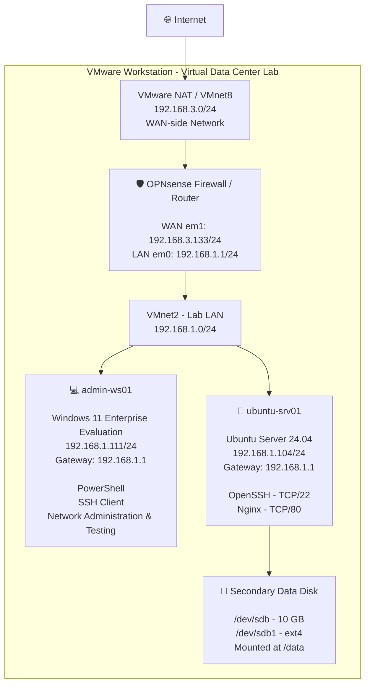

# Current Lab Architecture

The Mini Data Center Infrastructure Lab currently uses VMware Workstation to host an OPNsense firewall/router, a Windows administrative workstation, and an Ubuntu Linux server.



## Network Overview

### WAN Network

- **Network:** `192.168.3.0/24`
- **VMware Network:** `VMnet8`
- **Purpose:** Provides the external/WAN-side network for OPNsense
- **OPNsense WAN:** `192.168.3.133/24`

### Lab LAN

- **Network:** `192.168.1.0/24`
- **VMware Network:** `VMnet2`
- **Default Gateway:** `192.168.1.1`
- **Router/Firewall:** OPNsense

### Administrative Workstation

**Hostname:** `admin-ws01`

- Windows 11 Enterprise Evaluation
- IP: `192.168.1.111/24`
- Gateway: `192.168.1.1`
- Used for PowerShell administration, SSH access, connectivity testing, and remote server management

### Linux Server

**Hostname:** `ubuntu-srv01`

- Ubuntu Server 24.04
- IP: `192.168.1.104/24`
- Gateway: `192.168.1.1`
- OpenSSH on TCP/22
- Nginx on TCP/80

### Linux Data Storage

A secondary 10 GB virtual disk was added to `ubuntu-srv01`.

Storage configuration:

```text
/dev/sdb
   |
   └── /dev/sdb1
          |
          └── ext4 filesystem
                 |
                 └── /data
```

The filesystem is configured to mount persistently at `/data`.

## Traffic Flow

Traffic destined for systems outside the `192.168.1.0/24` lab LAN is sent to OPNsense at `192.168.1.1`.

OPNsense routes traffic from the internal VMnet2 network toward the VMware NAT network, providing the lab systems with external connectivity.

`admin-ws01` and `ubuntu-srv01` currently reside on the same `192.168.1.0/24` subnet and can communicate locally through VMnet2 without requiring OPNsense to route traffic between them.

## Future Architecture

A future phase of the project will introduce network segmentation by separating administrative and server systems into different networks.

This will provide hands-on practice with:

- Multiple subnets
- Inter-subnet routing
- Firewall policies
- Management-network isolation
- Server-network isolation
- Network access control
